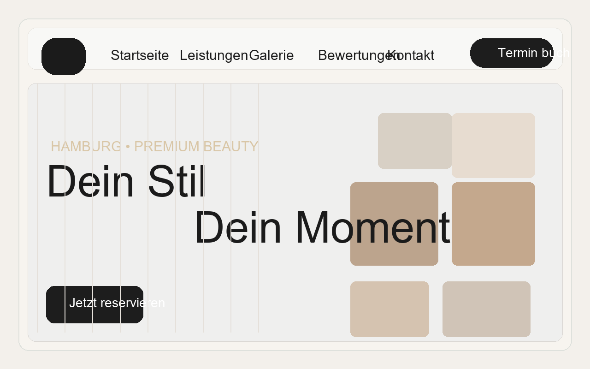

# Haarstudio ElbStyle

A premium salon landing page for a fictional luxury hair studio in Hamburg, Germany.

Built as a portfolio project to demonstrate frontend design, user experience, responsive layout, and conversion-focused marketing design.

## Screenshot



## Live Demo

- GitHub Pages: https://mrbegas.github.io/Haarstudio-ElbStyle/
- Local preview: http://localhost:8002/

## Project Overview

This project focuses on creating a polished, upscale presentation for a premium hair salon. The website is designed to feel elegant, modern, and trustworthy while clearly communicating services, contact information, and booking intent.

## Features

- Premium visual design with luxury salon styling
- Responsive layout for mobile, tablet and desktop
- Elegant hero section with strong brand message
- Services and offers presented in a clean structure
- Contact and booking CTA sections
- Modern typography and spacing system
- SEO-ready HTML structure
- Lightweight static build with no backend requirement

## Tech Stack

- HTML5
- CSS3
- JavaScript
- SEO metadata
- Static web hosting

## Project Structure

- `index.html` — main page structure and content
- `styles.css` — layout, styling, typography, colors and responsiveness
- `script.js` — interactions and small UI behaviors
- `robots.txt` — crawler guidance
- `sitemap.xml` — search engine sitemap
- `screenshot.png` — project preview image used in the README

## Run Locally

```bash
cd "C:\Users\sembe\Desktop\Moji Svi Projekti\Firzerski salon stranica"
python -m http.server 8002
```

Open in the browser:

```text
http://localhost:8002/
```

## Deployment

This project is suitable for static hosting platforms such as:

- GitHub Pages
- Netlify
- Cloudflare Pages

## Why This Project?

This project demonstrates:

- strong visual hierarchy
- premium business branding
- conversion-focused structure
- clean frontend code
- practical understanding of real-world landing page design

It is a strong example of a marketing-oriented landing page that can be used to present a service business, salon brand, or local business online.

## Portfolio Summary

"A premium salon landing page created to showcase a luxury brand identity, clean user experience, and polished conversion-focused web design. The project highlights responsive layout, elegant styling, and practical business presentation for a local service brand."
